*[English](README.md) · **Français***

# Daoa Mini

**Un tirage du Yi Jing, ligne à ligne, sur un ordinateur de poche.**
M5Stack Cardputer ADV · ESP32-S3 · écran 240 × 135 · hors-ligne.

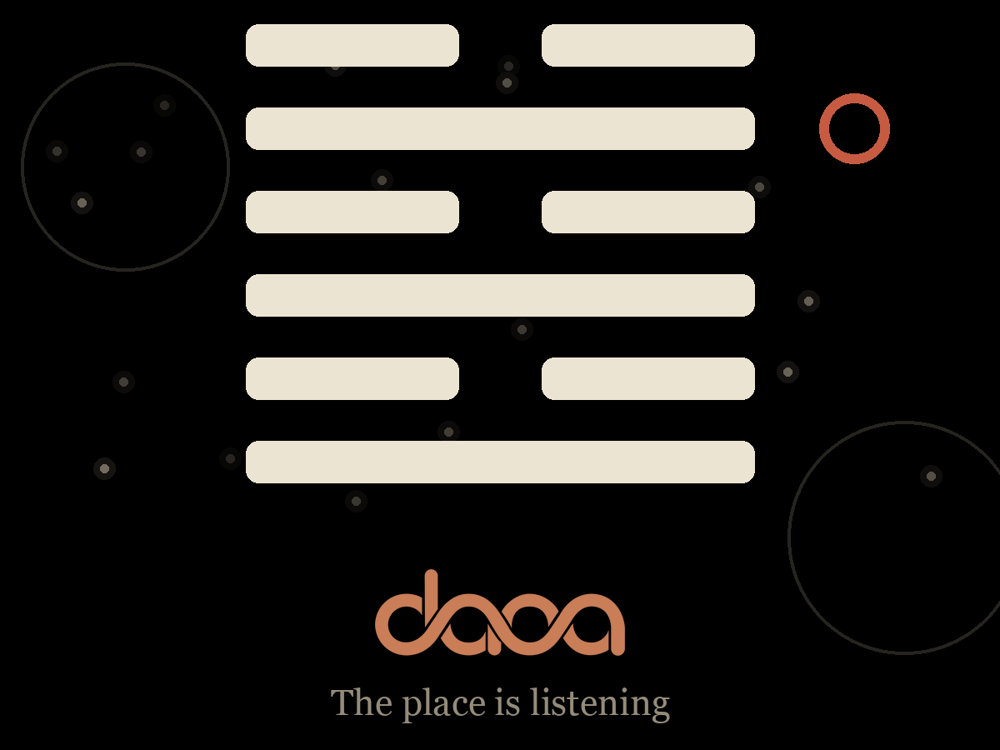

> ### Le lieu écoute.

Daoa Mini est un petit objet promotionnel pour l'app
[**Daoa**](https://daoa.app) (iPhone / Android) : on tire six lignes à la
méthode traditionnelle des trois pièces, l'appareil compose la figure, sa
figure complémentaire, et en donne le texte — en français ou en anglais.
Aucun réseau, aucun compte, aucune IA. Le hasard vient du générateur
matériel de l'ESP32.

Sa particularité : avant chaque tirage, l'appareil **écoute le lieu**.

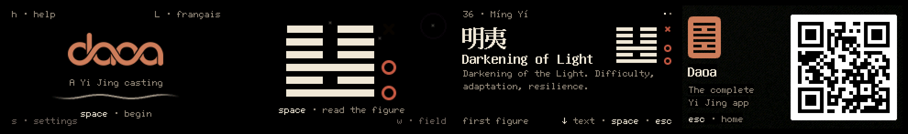

---

## Le lieu écoute

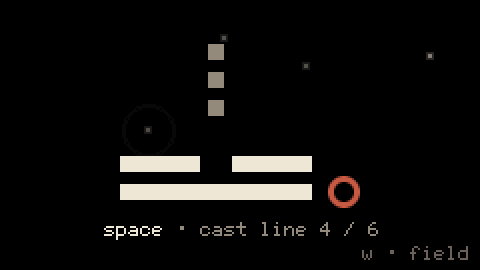

Un **scan WiFi passif** — jamais de connexion, radio coupée sitôt fini,
ni SSID ni BSSID collectés, rien n'est stocké ni transmis — devient un
champ de particules : une par réseau perçu, sa position dérivée du canal,
sa luminance de la force du signal. Les particules dérivent, respirent,
émettent des ondes concentriques, et s'illuminent quand un trait se pose.

Ce champ **pondère le tirage**, de façon bornée et documentée :

| Lecture | Dérivée de | Effet |
|---|---|---|
| **densité** | nombre de réseaux + énergie moyenne | penche yin ou yang, **± 5 % au plus** |
| **agitation** | étalement des canaux + variance des signaux | rend les mutations plus probables, **+ 4 % au plus** |

Le tirage reste réel : le TRNG matériel est l'unique source d'aléa, et
l'utilisateur ne choisit jamais rien. La fonction est **activée par
défaut**, coupable dans les réglages (`s`), et intégralement inspectable
avec la touche `w` :

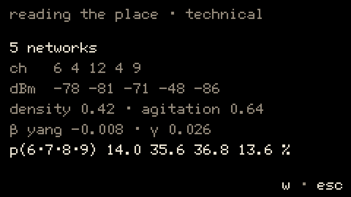

> Réseaux, canaux, dBm, densité, agitation, β, γ, et les probabilités
> résultantes des quatre valeurs de ligne. La transparence est la
> condition de la règle : voir [docs/03](docs/03_MECANIQUE_TIRAGE.md).

---

## Les écrans

| | |
|:--:|:--:|
| 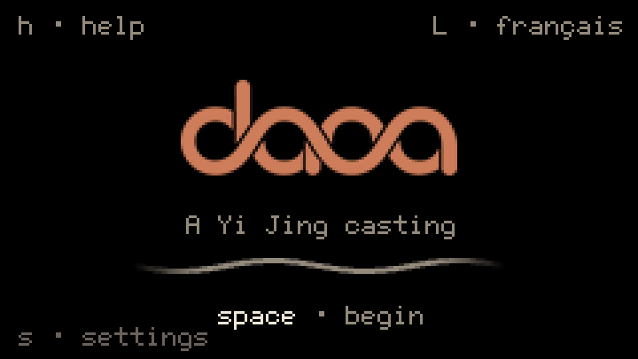 | 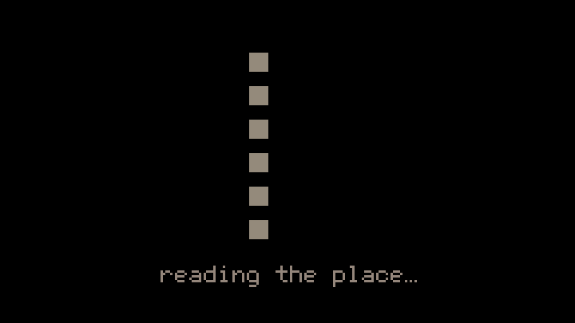 |
| **Accueil** — le lettermark, la respiration de l'invite | **Lecture du lieu** — ~1,4 s : le temps du scan devient le rituel |
| 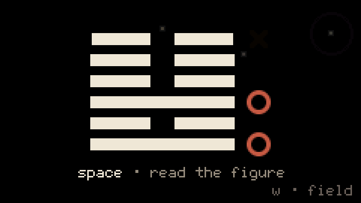 | 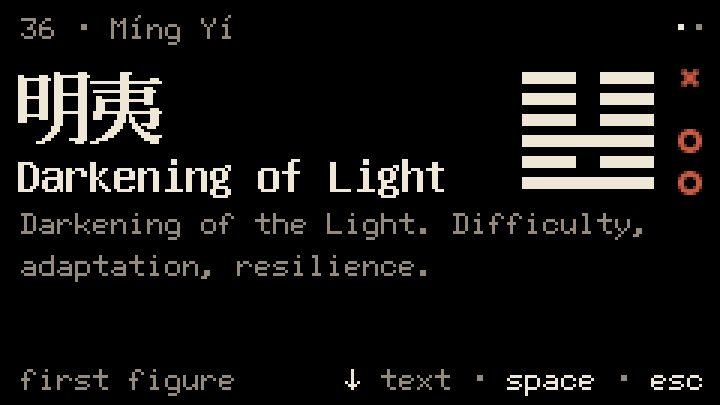 |
| **Tirage** — six traits de bas en haut, marques cinabre sur les mutables | **Résultat** — sinogramme, nom, glose, mini-figure, deux pages |
| 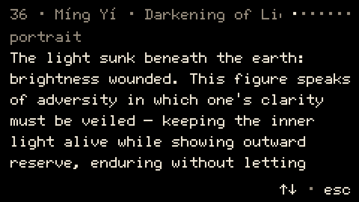 | 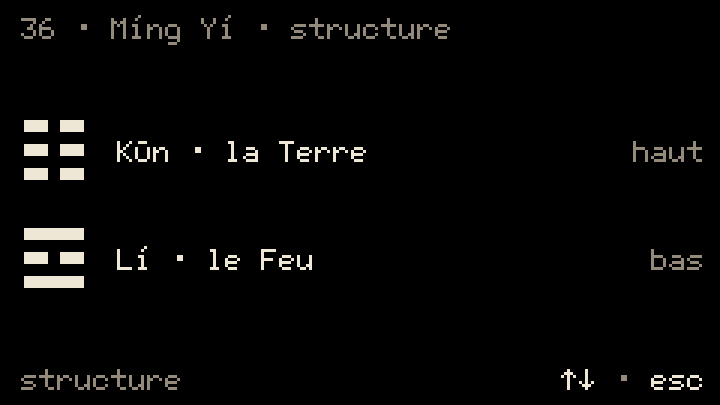 |
| **Lecture** — portrait, Jugement, Image, sens des six traits | **Structure** — les deux trigrammes, dérivés des traits |
| 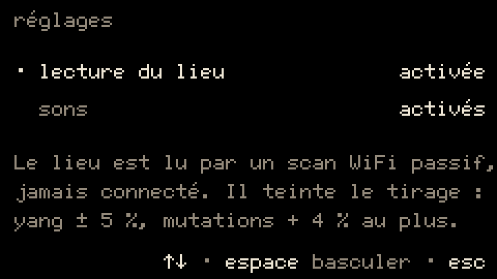 |  |
| **Réglages** — lecture du lieu, sons, volume ; persistants | **Promo** — QR vers l'app complète |

---

## Prise en main

| Touche | Effet |
|---|---|
| `espace` | commencer, tirer une ligne, avancer |
| `←` `→` | figure obtenue ↔ figure complémentaire |
| `↓` | texte complet de la figure ; puis pages ; puis structure |
| `↑` | revenir en arrière dans les pages |
| `l` | français ↔ anglais |
| `h` | aide embarquée (7 sections) |
| `s` | réglages (lecture du lieu, sons, volume) |
| `w` | vue technique du champ |
| `esc` | retour |

Les sons sont des sinusoïdes PCM à décroissance douce, jamais un buzzer
carré : les six traits égrènent une **pentatonique montante** (A5 → A6),
une quinte au-dessus marque les lignes mutables, une quinte descendante
résout à l'arrivée du résultat.

<details>
<summary>Pourquoi cette gamme est deux octaves plus haut qu'elle « devrait »</summary>

La gamme a d'abord été écrite là où elle se lit naturellement sur le
papier — A3 à A4, 220 à 440 Hz. Sur l'appareil, le tirage était
**totalement muet** alors que les ticks d'interface s'entendaient très bien.

Rien à reprocher au code : un micro haut-parleur de 1 W dans un boîtier de
poche résonne autour de 1 kHz et s'effondre sous ~400 Hz. Les notes étaient
jouées, fidèlement, dans une bande que le matériel ne sait pas restituer.
Transposer toute la gamme de deux octaves — rapports musicaux intacts,
registre déplacé dans la bande efficace — a réglé le problème. Bon à savoir
avant de composer quoi que ce soit pour ce genre d'appareil.

</details>

---

## La mécanique

Six lignes, tirées **de bas en haut**. Chacune vaut 6, 7, 8 ou 9 :

| Valeur | Nature | Trait | Mutable |
|:--:|---|---|:--:|
| 6 | vieux yin | brisé, marqué d'une croix | → yang |
| 7 | jeune yang | plein | — |
| 8 | jeune yin | brisé | — |
| 9 | vieux yang | plein, marqué d'un cercle | → yin |

**Probabilités traditionnelles des trois pièces** : 1/8, 3/8, 3/8, 1/8 —
un écart volontaire par rapport à Daoa v1, qui tirait uniforme. Les
mutations redeviennent des événements rares, donc lisibles.

Les six lignes réduites en yin/yang donnent 6 bits → un numéro **King
Wen** par table de correspondance (ordre Javary/Faure). Les lignes
mutables transformées donnent la **figure complémentaire** : celle vers
laquelle la situation tend.

<details>
<summary><b>Le détail qui a failli nous piéger</b> — pourquoi on ne biaise pas les pièces</summary>

L'idée naturelle pour pondérer le tirage était de biaiser les pièces
elles-mêmes : P(face) = 0,5 + ε. Elle est **mathématiquement inopérante**.

Dans la méthode des trois pièces, une ligne est yang quand le nombre de
faces est **impair** (7 = une face, 9 = trois faces). Or la parité d'un
tirage binomial est remarquablement insensible au biais :

$$P(\text{impair}) = \frac{1 - (1-2p)^3}{2}$$

En posant $p = 0{,}5 + \varepsilon$, tout s'effondre jusqu'au **troisième
ordre** : $P(\text{yang}) = 0{,}5 + 4\varepsilon^3$. Avec un biais de 5 %,
l'effet réel serait de **0,05 %** — mille fois trop faible, indétectable.

La construction retenue agit donc au niveau de la ligne, en deux
Bernoulli indépendantes, strictement équivalentes à la tradition quand
elles ne sont pas pondérées :

```
P(yang)   = 0,5  + β      β = (densité − 0,5) × 0,1   ∈ [−0,05, +0,05]
P(vieille)= 0,25 + γ      γ = agitation × 0,04        ∈ [0, 0,04]
```

À β = γ = 0, on retrouve exactement 1/8, 3/8, 3/8, 1/8. Les seuils sont
comparés sur des champs de 10 bits du TRNG (512/1024 et 256/1024 : exacts,
sans biais de modulo). Un test vérifie la neutralité, un autre que l'effet
reste borné aux plafonds.

</details>

---

## Le matériel

| | |
|---|---|
| **MCU** | ESP32-S3FN8 (StampS3A), Xtensa LX7 double cœur @ 240 MHz |
| **Mémoire** | 8 Mo flash, 512 Ko SRAM, **pas de PSRAM** |
| **Écran** | ST7789V2, 1,14″, **240 × 135**, soit ~25 × 14 mm à ~245 ppi |
| **Clavier** | 56 touches, contrôleur I²C **TCA8418** |
| **Audio** | codec ES8311 + NS4150B + haut-parleur 1 W |
| **Divers** | IMU BMI270, IR, microSD, batterie 1500 mAh (1750 mAh sur les exemplaires d'avant juillet 2026) |

Empreinte du firmware : **3,47 Mo de flash** (41 % des 8 Mo) et
**50,9 Ko de RAM** (15,5 %). Le framebuffer plein écran est un sprite
16 bits de 64,8 Ko en SRAM : tout se dessine hors écran puis se pousse en
un bloc — zéro scintillement.

---

## Compiler, simuler, flasher

```bash
brew install platformio sdl2
```

```bash
# Tests de la logique pure (20 cas, sans matériel)
pio test -e test-native

# Simulateur macOS : fenêtre SDL 240 × 135 zoomée ×3
pio run -e sim && ./.pio/build/sim/program

# Firmware, Cardputer branché en USB
pio run -e cardputer-adv -t upload
```

Trois environnements PlatformIO : le firmware (Arduino-ESP32 3.x via
pioarduino), le **simulateur SDL** et les **tests natifs**.

### Le simulateur

Tout le rendu passe par l'API `lgfx::` — jamais par le matériel — si bien
que le **même code** dessine sur l'appareil et sur le Mac. C'est ce qui
rend l'itération visuelle supportable : pas de flash de 30 s pour bouger
un pixel de 2 px. Il sait aussi produire des captures déterministes :

```bash
./.pio/build/sim/program --shot   <dossier>   # 17 écrans, aléa fixé
./.pio/build/sim/program --frames <dossier>   # 60 frames du champ animé
./.pio/build/sim/program --seed   <n>         # rejouer un tirage précis
./.pio/build/sim/program --fonttest <dossier> # couverture des glyphes
```

Toutes les images de ce README en sortent.

---

## Architecture

```
src/
  core/       logique pure — C++17, zéro dépendance Arduino/M5, testée en natif
    casting   machine à états du tirage, table King Wen
    ambient   lecture du lieu → pondérations bornées
  ambient/    frontière matérielle : scan WiFi réel / scan simulé
  sound/      synthèse PCM des sons d'interface
  ui/         tokens du design system, composants LovyanGFX, écrans
  content/    corpus généré (non versionné, voir plus bas)
  sim/        entrée SDL — captures, frames, graines
  main.cpp    entrée appareil — mapping clavier TCA8418
```

L'aléa est **injecté** (`uint32_t (*)()`) : `esp_random()` sur l'appareil,
PRNG déterministe en test et au simulateur. De même pour le scan WiFi et
la persistance : `core/` ne connaît que des interfaces, ce qui le rend
entièrement testable sur une machine de bureau.

### Le design system

L'interface suit un micro design system dédié, dont chaque cote est une
`constexpr` de [`src/ui/daoa_tokens.h`](src/ui/daoa_tokens.h) et chaque
composant une fonction de rendu de
[`src/ui/components.cpp`](src/ui/components.cpp) :

- **135 n'est pas divisible par 4** — donc pas de grille verticale, mais
  trois bandes fixes : en-tête 18, contenu 99, pied 18.
- Colonne de 228 px = **38 caractères** à 6 px d'avance ; trois tailles de
  fonte (12 / 16 / 24), interligne = hauteur + 2.
- Traits yin/yang en trois tailles, rapport épaisseur/largeur tenu à 1:12.
- Cinq couleurs, pas une de plus. **Papier** pour ce qui parle du tirage,
  **pierre** pour ce qui parle de l'interface, **cinabre** réservé aux
  marques de mutation, **terracotta** réservé à la marque.
- Aucune ombre, aucune bordure, aucune carte : les bandes se lisent par
  le vide. À 245 ppi sur fond noir, un filet de 1 px attire plus l'œil
  que le texte qu'il sépare.

### Le tour des fontes

Les DejaVu de M5GFX sont **ASCII pur** : aucun accent, découvert en
affichant « Créatif ». Après mesure au simulateur, le texte courant passe
en **efontJA** (qui couvre le latin accentué) et les sinogrammes en
**efontCN 24 bold** — sauf 遯 (33), 夬 (43) et 姤 (44), absents de la
fonte CN, qui basculent sur efontJA. Une fonte VLW dédiée aux 64 glyphes
exacts est au programme.

---

## Ce que ce dépôt ne contient pas

Le dépôt est public, il contient le **moteur** — pas la marque ni le
contenu Daoa. Sont exclus, et purgés de l'historique :

- les livrables de design et les assets de marque ;
- les en-têtes **générés** qui encodent marque ou contenu : le corpus
  bilingue des 64 figures et les masques bitmap.

`src/core/kingwen_table.h` reste public : c'est du patrimoine
mathématique, pas du contenu Daoa.

**Conséquence assumée : un clone public ne compile pas tel quel.** Les
scripts `scripts/extract_content.py` et `scripts/convert_assets.py`
régénèrent ces en-têtes depuis des sources privées. Le code, l'architecture
et la mécanique restent entièrement lisibles — c'est ce qui a de la valeur
pour qui passe par là.

---

## Documentation

| | |
|---|---|
| [CLAUDE.md](CLAUDE.md) | doctrine du projet, garde-fous, décisions techniques |
| [docs/00](docs/00_ANALYSE_BESOINS.md) | analyse initiale : matériel, libs, outils |
| [docs/01](docs/01_DECISIONS.md) | journal des décisions actées |
| [docs/02](docs/02_ARCHITECTURE.md) | arborescence, environnements, pipeline de contenu |
| [docs/03](docs/03_MECANIQUE_TIRAGE.md) | **spécification du tirage** — source de vérité |
| [docs/04](docs/04_UX_RENDU.md) | écrans, direction visuelle, fontes, animations |
| [docs/05](docs/05_ROADMAP.md) | phases et état courant |

---

## Licence

Le **code** de ce dépôt est publié sous [licence MIT](LICENSE) — servez-vous,
apprenez-en, construisez dessus.

Ce que la licence ne couvre pas, parce que ce n'est pas dans le dépôt :
la **marque Daoa** (lettermark, sceau, identité visuelle) et le **corpus
Yi Jing** écrit pour Daoa. Ils restent propriétaires, et sont régénérés
localement depuis des sources privées.

---

## Sur les textes

Les textes des 64 figures — portrait, Jugement, Image, sens des six
traits — sont des formulations **propres à Daoa**, écrites dans un souci
de fidélité aux traductions du domaine public : James Legge (1882) pour
l'anglais, Charles de Harlez (1889) pour le français. Rien n'est repris
mot pour mot d'une traduction protégée.

Le Yi Jing y est présenté comme un texte de réflexion, pas comme un
oracle. L'appareil décrit ; il ne prédit pas.

---
